
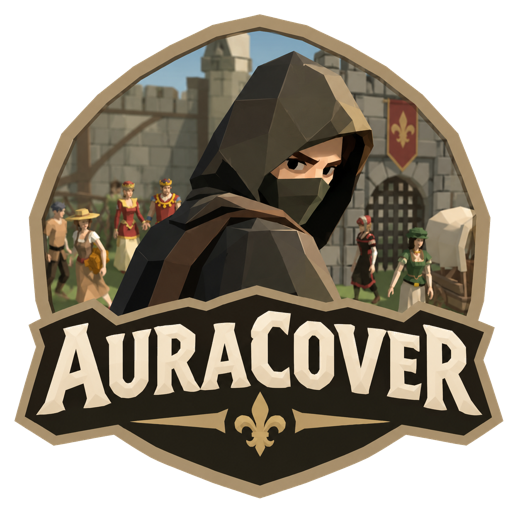

# Aura Cover

Un **Undercover en 3D**, de **3 à 12 joueurs en ligne**, chacun sur son PC Windows.
Le roi vous a convoqués autour du feu de camp : des traîtres se cachent parmi vous. Écrivez vos indices, débattez sur Discord, accusez… et le roi tranche la tête du désigné.

## ⬇️ Télécharger

### **[Télécharger Aura Cover v0.7 pour Windows](https://github.com/artercamille/auracover-jeu/raw/main/AuraCover.zip)**

Dézippe le fichier, puis lance `AuraCover.exe`.
Si Windows affiche « Windows a protégé votre ordinateur » : *Informations complémentaires* → *Exécuter quand même*.

Tout le monde doit avoir **la même version**. Un bouton rouge apparaît sur l'écran titre quand une nouvelle version sort.

## 🔥 Jouer ensemble

1. Celui qui héberge clique sur **Allumer un feu** et donne son adresse IP aux autres (bouton *Copier* dans le salon).
2. Les autres collent cette IP et cliquent sur **Rejoindre**.
3. Chacun choisit son villageois, l'hôte règle la partie et clique sur **Lancer la partie**.

Pour se connecter, au choix :
- **Radmin VPN** (gratuit, le plus simple) : tout le monde rejoint le même réseau, l'IP commence par `26.`
- **Ouvrir le port** sur la box de l'hôte : **UDP 7777** vers son PC, puis donner son IP publique.

Si Windows demande l'accès au réseau au premier lancement : cocher **Privé et Public**.

## ⚔️ Les règles

- Les **civils** ont tous le même mot, les **undercovers** un mot proche. **Mr. White** n'a pas de mot. Personne ne sait s'il est civil ou undercover !
- Chacun son tour (ordre au hasard, Mr. White ne commence jamais), écris un **indice** sur ton mot. Interdit d'écrire ton propre mot.
- **Débat** en vocal sur Discord, puis **vote** : vise un villageois et clique pour l'accuser.
- Le plus accusé est conduit au **billot** et le roi lui tranche la tête. Égalité : on revote. Encore égalité : le roi choisit.
- Si c'est **Mr. White**, la lame s'arrête : il a 30 secondes pour deviner le mot des civils. S'il trouve, il est gracié et gagne !
- Les éliminés deviennent **spectateurs** : ils voient tous les rôles et regardent par les yeux des autres.
- Les civils gagnent quand tous les traîtres sont tombés. Les traîtres gagnent s'il ne reste qu'un civil.
- Points : civils **+2**, undercovers **+10**, Mr. White **+6**. « Rejouer » garde les scores.

## 🏰 Dans le jeu

| | |
|---|---|
| 👁️ **Vue subjective** | Assis autour du feu, tu tournes la tête à la souris et tu vois les autres tourner la leur. |
| 🧑‍🌾 **13 villageois** | Meunier, Lavandière, Bûcheron, Reine… chacun choisit le sien, avec aperçu 3D dans le salon. |
| 🗡️ **Le bourreau** | Le roi suit les débats, donne ses ordres, et exécute à l'épée le condamné qui marche jusqu'au billot. |
| 😂 **Réactions** | Touches 1 à 6 : rire, surprise, « C'est lui ! », applaudir, réfléchir, « non non non ». |
| 🪶 **Indices** | Dans une bulle au-dessus de chaque joueur, et l'historique de toutes les manches avec **Tab**. |
| 🏆 **Stats de fin** | Le plus suspecté, le fin limier, le bourreau d'innocents. |
| 🔌 **Reconnexion** | Si quelqu'un plante, il garde sa place et revient avec le même pseudo. |
| 🤖 **Bots** | L'hôte peut ajouter des bots pour tester tout seul. |
| 📝 **Mots maison** | 157 paires de mots entre potes. |

**Commandes** : souris = tourner la tête · clic = accuser (pendant le vote) · Entrée = envoyer l'indice · **V** = prêt à voter · **P** = passer au vote (hôte) · **Tab** = historique des indices · **1 à 6** = réactions · Échap = pause et paramètres · F11 = plein écran.

## 📸 Captures

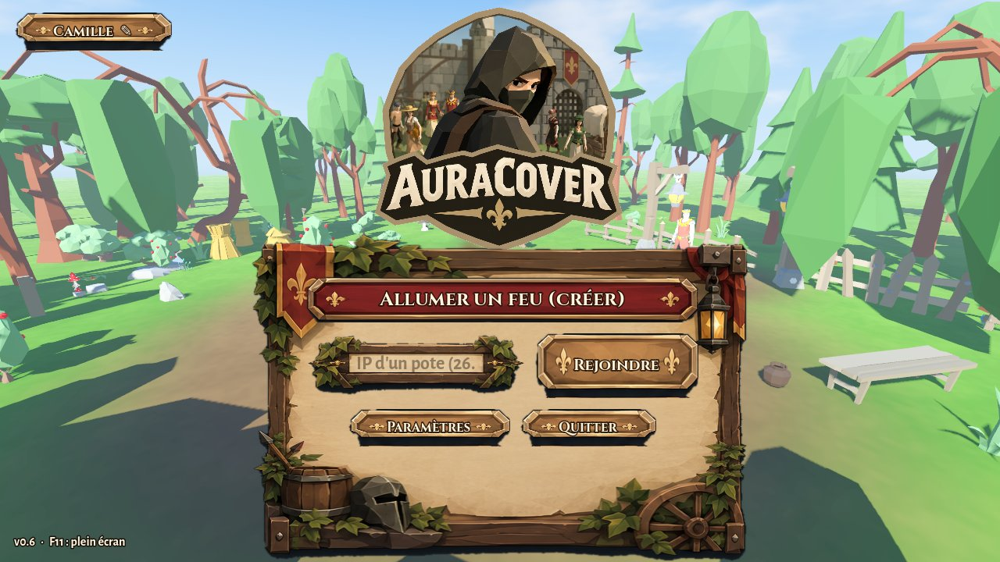 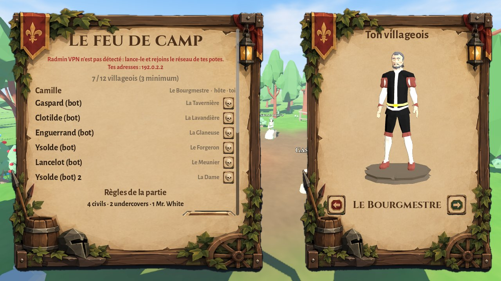
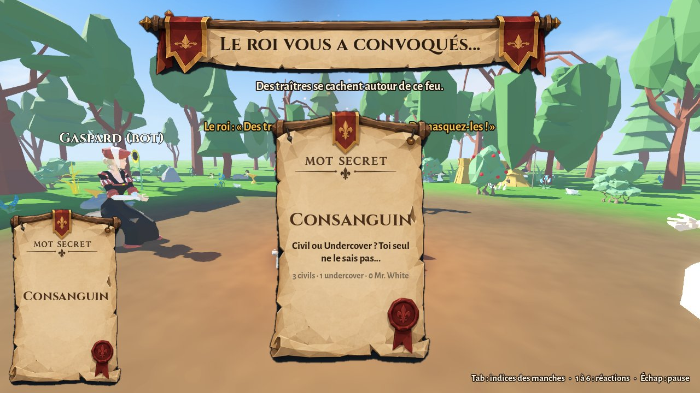 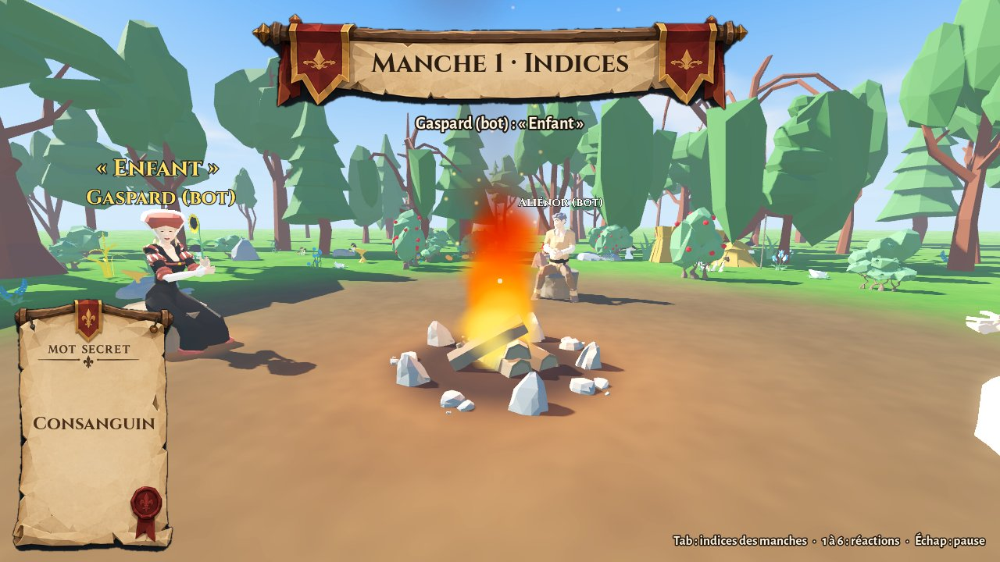
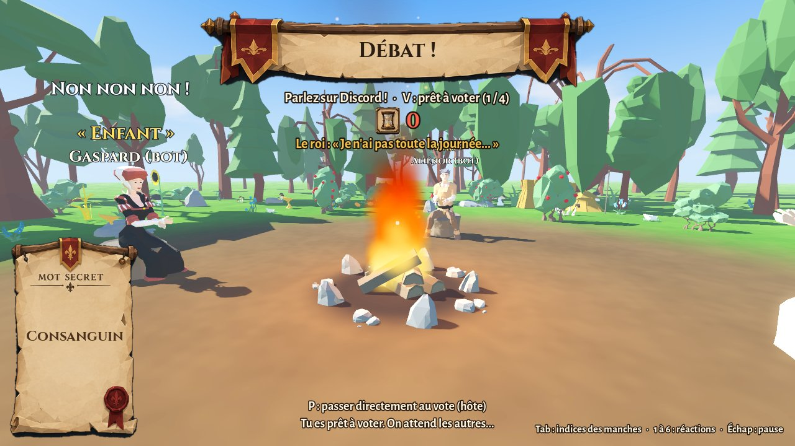 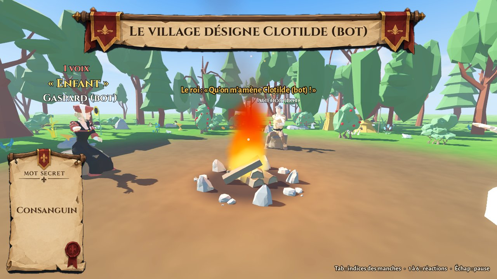
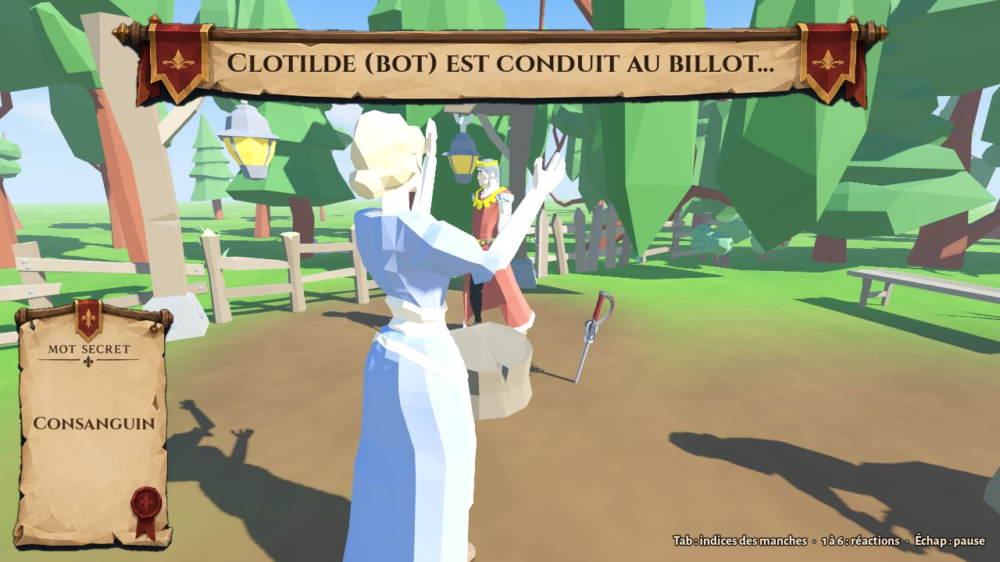 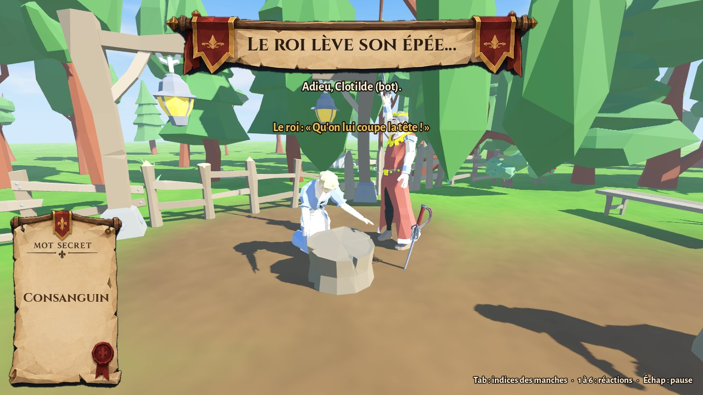
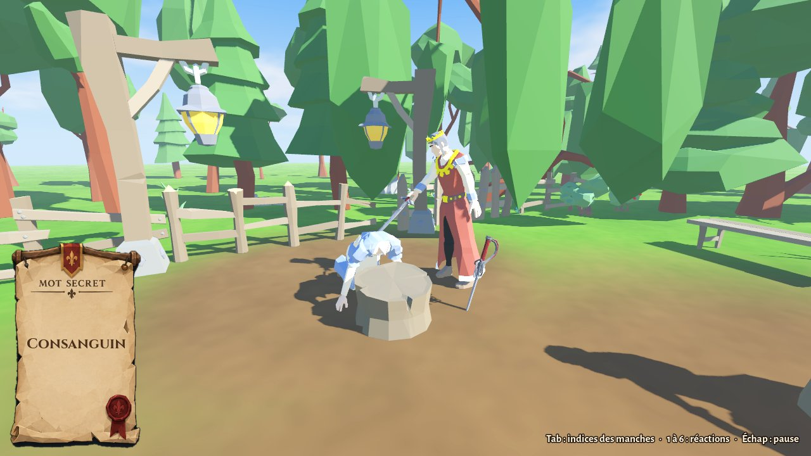 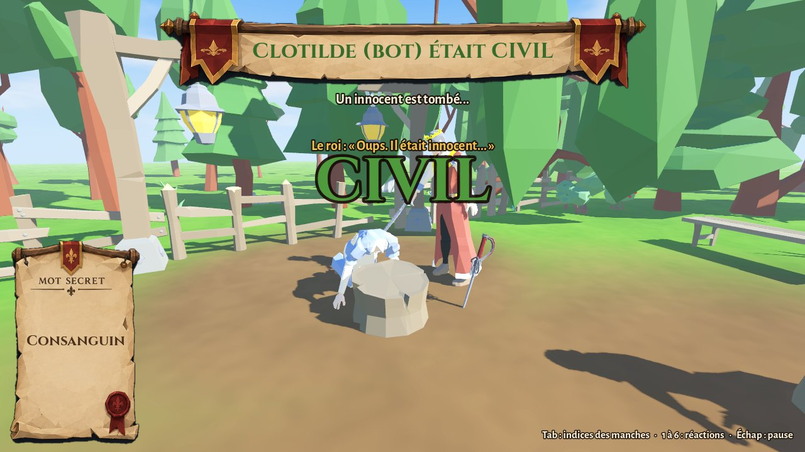
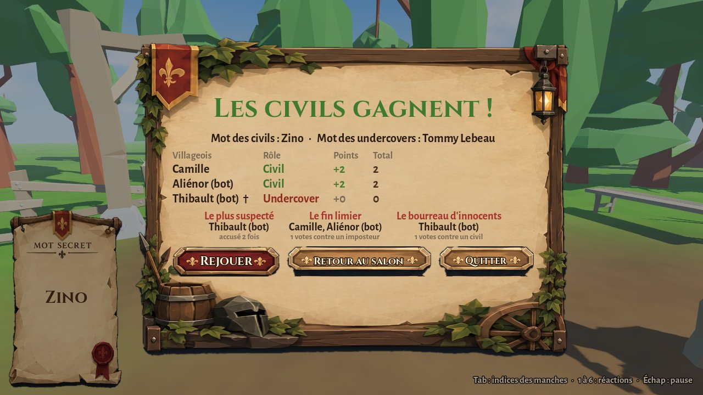

## Crédits

- Modèles 3D : [Craftpix.net](https://craftpix.net)
- Interface et logo : Camille
- Polices : Cinzel et Alegreya Sans (SIL Open Font License)
- Sons d'interface : [Kenney](https://kenney.nl) (CC0) · musique et ambiance générées pour le jeu
- Fait avec [Godot 4.3](https://godotengine.org/)
